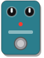
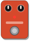
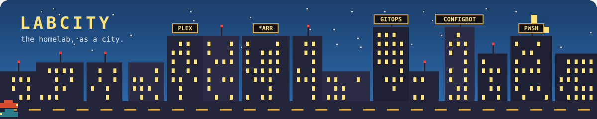

<div align="center">

<a href="https://www.mattskare.com"></a>

<a href="https://www.mattskare.com"></a>

<a href="https://www.mattskare.com"></a> <a href="https://bsky.app/profile/mattskare.com"></a> <a href="https://x.com/MattSkare"></a> <a href="https://github.com/Matt-Skare"></a>

</div>

<br>

Hey, I'm **Matt**. By day I do automation, CI/CD and endpoint management, mostly **PowerShell** and **Intune**. I use AI to make the boring stuff *even more* boring. After hours I'm building apps for gigging musicians, wiring up a homelab, and playing guitar.

```powershell
PS mattskare.com:\> Get-Matt | Format-List

Name      : Matt Skare
DayJob    : Automation, CI/CD, endpoint management
Shell     : PowerShell 7
Building  : StageCue for Android
Homelab   : labcity (the homelab, as a city)
Plays     : Guitar, piano, drums
Also      : Dogs
```

## 🎛️ On the board

<table>
<tr>
<td width="50%" align="center" valign="top">
<br>
<a href="https://www.mattskare.com/projects/"></a>

### [StageCue](https://www.mattskare.com/projects/)

Live setlists and quick stage notes for gigging musicians.


<br><br>
</td>
<td width="50%" align="center" valign="top">
<br>
<a href="https://github.com/mattskare/configbot"></a>

### [configbot](https://github.com/mattskare/configbot)

Configuration management for the homelab.


<br><br>
</td>
</tr>
<tr>
<td width="50%" align="center" valign="top">
<br>
<a href="https://github.com/mattskare/scripts"></a>

### [scripts](https://github.com/mattskare/scripts)

A collection of useful scripts for the boring stuff.


<br><br>
</td>
<td width="50%" align="center" valign="top">
<br>
<a href="https://github.com/mattskare/configs"></a>

### [configs](https://github.com/mattskare/configs)

Shell profiles, terminal settings and other dotfiles.


<br><br>
</td>
</tr>
</table>

> [!TIP]
> The real pedalboard lives at **[mattskare.com](https://www.mattskare.com)**. Stomp a pedal for a fun fact, or press <kbd>`</kbd> for a shell.

## 🧰 Tools I reach for

<div align="center">
<table>
<tr>
<td align="center" width="25%"><sub><b>SCRIPTING</b></sub><br><br>
<picture><source media="(prefers-color-scheme: dark)" srcset="https://skillicons.dev/icons?i=powershell,bash,python&theme=dark"></picture>
</td>
<td align="center" width="25%"><sub><b>ENDPOINT &amp; CLOUD</b></sub><br><br>
<picture><source media="(prefers-color-scheme: dark)" srcset="https://skillicons.dev/icons?i=windows,azure,linux&theme=dark"></picture>
</td>
<td align="center" width="25%"><sub><b>CI/CD &amp; INFRA</b></sub><br><br>
<picture><source media="(prefers-color-scheme: dark)" srcset="https://skillicons.dev/icons?i=githubactions,terraform,docker&theme=dark"></picture>
</td>
<td align="center" width="25%"><sub><b>APPS &amp; WEB</b></sub><br><br>
<picture><source media="(prefers-color-scheme: dark)" srcset="https://skillicons.dev/icons?i=androidstudio,firebase,ts&theme=dark"></picture>
</td>
</tr>
</table>
</div>

## 🏙️ After hours

<div align="center">



<sub>Plex, the *arr stack and a pile of GitOps, all running at home. Most of it is private; some of it is in <a href="https://github.com/mattskare/configbot">configbot</a>.</sub>

<br><br>


<sub>© 2026 Matt Skare · hand-wired, no frameworks</sub>

</div>
